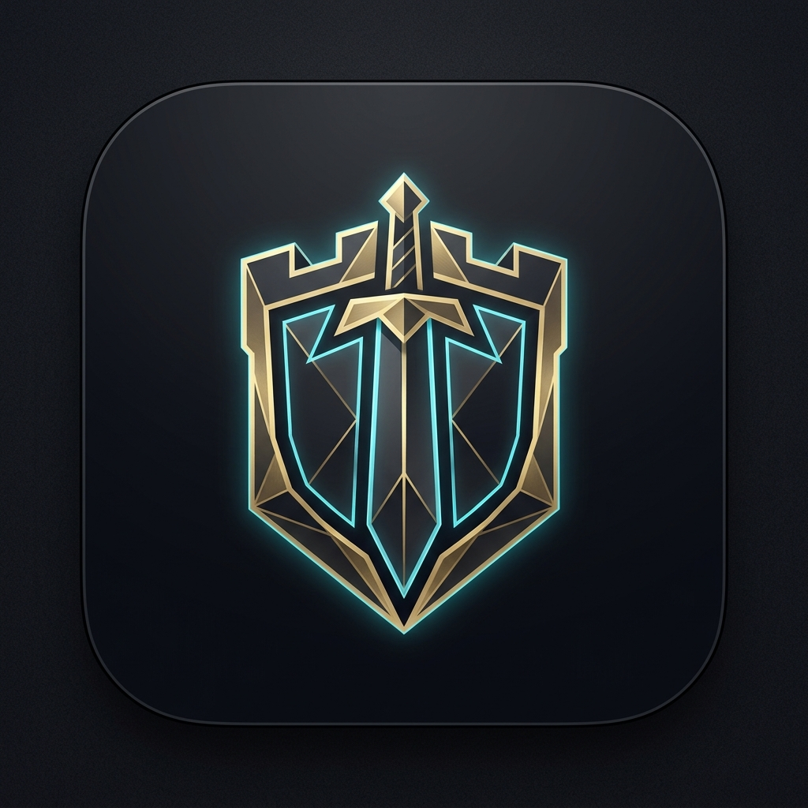

# ⚔️ 部落冲突助手 (v1.2)

  
   
  <b>原生 Android + Jetpack Compose 打造的《部落冲突》村庄升级提醒与多账号管理利器</b>

---

## 🌟 核心特色与功能

1. **⚡ 一键游戏内村庄数据同步（免手动逐个录入）**
   - 完美适配《部落冲突》官方数据导出功能（*游戏内「设置」➔「更多设置」➔「Data Export」➔「Export Village data in JSON format」*）。
   - 一键粘贴 JSON，自动读取所有正在升级的建筑、城墙、实验室科技、法术、战宠及攻城机器。
   - 所有建筑与科技名称 100% 遵照权威网站 **部落小站 (`coc.zmmmgo.cc.cd`)** 标准汉化对齐（已全面适配 18 本最新战宠【贪婪渡鸦 Greedy Raven】、跳弹加农炮、多人箭塔、巨石碑、火焰喷射器等）。
   - **精确时间对齐**：直接对齐游戏导出的剩余秒数，消除跨机时间差导致的倒计时偏差。
   - **学徒工人/实验助理独立标识**：自动区分常规 6 位建筑工人和建筑工人学徒/实验室学徒加速，不挤占常规工人序号。

2. **👑 多账号直接并排显示与秒切**
   - 顶部直接平铺展示所有账号（大号、部落战小号、躺王小号等），点击即可瞬间秒切，各账号升级槽位完全独立隔离。
   - 支持随便自定义名称直接新建账号，随后一键粘贴 JSON 即可全量同步首领标签与大本营等级。

3. **⏰ 硬件级精准系统闹钟提醒与开机自启**
   - 基于 Android 原生 `AlarmManager.setExactAndAllowWhileIdle` 硬件 RTC 唤醒。
   - 升级完成时发出高优先级震动与声音横幅提醒（标明账号名称、工人编号与升级完成的工程），防止工人摸鱼。
   - 完美支持设备关机重启（`BOOT_COMPLETED` 广播接收），手机开机后全自动恢复所有账号的未完成升级定时提醒。

4. **🔋 极致省电与极低内存占用**
   - 前台采用生命周期协程驱动倒计时，退到后台完全暂停，后台纯硬件唤醒 **0 耗电**。
   - 运行时常驻内存仅 40~60 MB。

5. **🚀 内置 GitHub Releases 自动检测与应用内一键升级**
   - 顶部一键点击检查更新，支持在应用内直接查看新版本日志、实时进度条下载 APK 并一键平滑覆盖安装（保留全部账号与进度数据）。

---

## 📥 最新版本下载

* **当前版本**：`v1.2`
* **下载地址**：可在本仓库的 [Releases 页面](https://github.com/zmmmgo/clashtool/releases) 直接下载 `ClashTool_v1.2.apk`。
* **应用内在线更新**：已安装旧版本的玩家可在 App 顶部导航栏点击 **🚀** 按钮一键检测并更新至最新版本！

---

## 🛠️ 技术架构

* **编程语言**：Kotlin 2.0+
* **界面框架**：Jetpack Compose + Material 3 (深色沉浸式暗黑风格)
* **定时与通知**：AlarmManager + NotificationManager (渠道级高优先级)
* **网络与解析**：HttpURLConnection + org.json 原生轻量解析
* **数据持久化**：SharedPreferences (JSON 结构化多账号存储)

---

## 📄 开源协议

本项目仅供《部落冲突》玩家个人学习与交流使用。所有游戏素材、名称版权均归 Supercell 所有。
